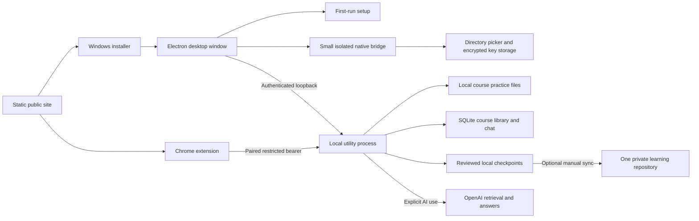

# OutClass Windows desktop preview

The public site showcases the product and setup. The Windows download contains Learn, Academy, Creator Studio and GTM. See [the current release](releases/0.8.0.md) for capabilities and account requirements. Historical GitLearn app-data paths remain compatible.

## Architecture



The renderer has no Node access and runs with context isolation and sandboxing. Only the main frame can invoke the narrow native bridge. The companion uses the bundled Electron runtime for JavaScript; Python and Git are local prerequisites. Learner folders, API credentials, and app data are excluded from installer resources. Native API keys use Electron safeStorage backed by Windows account encryption and are transferred to the companion over private IPC. Development can still read the project's .env, but packaged apps never do.

The installed app uses the existing `LOCALAPPDATA/GitForLearning` companion database so an existing user's local course history is retained. Native preferences and encrypted keys live in Electron's GitLearn user-data directory. A matching-version standalone companion already listening on GitLearn's port can be reused; an older running version must be closed before updating; close it and reopen the desktop app to manage keys from the native UI. The installer retains learning files and app data on uninstall.

## Build and use

```powershell
npm ci
npm run build
npm run desktop
npm run package:desktop
npm run package:extension
npm run preview:site
```

- Installer: `dist/releases/OutClass-Setup-0.8.0.exe`.
- Chrome upload: `dist/releases/OutClass-Chrome-0.8.0.zip`.
- Public site only: `dist/site/`; no workspace APIs or application build required by the host.
- Native workspace: `dist/desktop/` and `dist/web/` plus runtime dependencies.

The first launch guides the learner through a parent learning folder, optional AI, and browser pairing. Example folder:

```text
Desktop/My Learning/
  history/       # one Git repository, all course checkpoints
    udemy/<course>/<section>/<lesson>/
  workspaces/    # real editable files, separate from history
    udemy/<course>/<section>/<lesson>/
  projects/      # optional evolving course projects
    udemy/<course>/
```

The installer keeps the extension in resources/extension as ordinary files outside ASAR. The native app copies it into a version-specific folder in app data when the learner clicks Open included extension folder. Chrome can Load unpacked from that actual folder. Pair once; after pairing, Open my workspace focuses the desktop window when its own companion is running. Existing browser-only companion users retain the browser fallback.

## Distribution state

This is an unsigned Windows x64 preview. The last verified Chrome item `iaokfcjeghdefpgcgbcomiehhogbkbcp` was pending review; it does not establish approval of the current package. Use the matching preview ZIP with Load unpacked until an updated store release is verified. Set chromeStoreUrl in static release metadata only after public availability is confirmed.

Release assets belong in GitHub Releases, not Git source history. The site uses verified release asset URLs once uploaded and degrades to the release page when metadata or JavaScript is unavailable. The user selected Vercel for hosting. Import the repository using the committed vercel.json; see vercel-deployment.md.

## Verification

Use `npm run check`, `npm test`, `npm run test:desktop`, `npx playwright test --config playwright.site.config.ts`, and the existing workflow suite. The desktop test uses its own temporary profile, database, learning folder, and port; it does not alter the user's setup or contact OpenAI. Set GITLEARN_PACKAGED_TEST to the unpacked packaged OutClass.exe to exercise the actual distributed runtime. The page tests exercise desktop/mobile, keyboard tabs, privacy, no JavaScript, live reduced-motion switching, and absence of workspace API calls.
